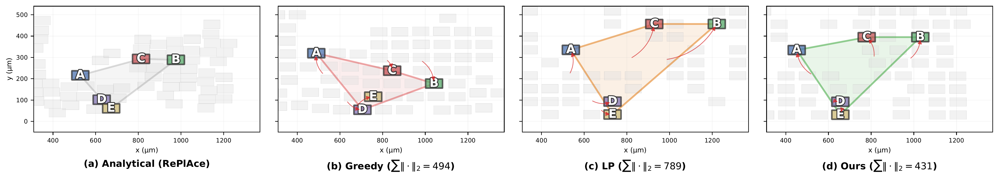
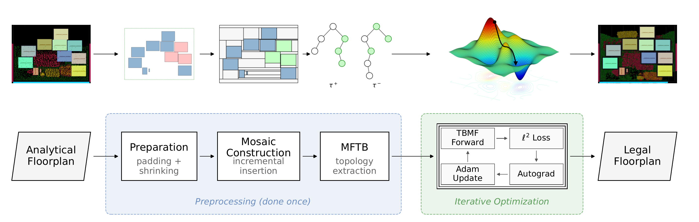
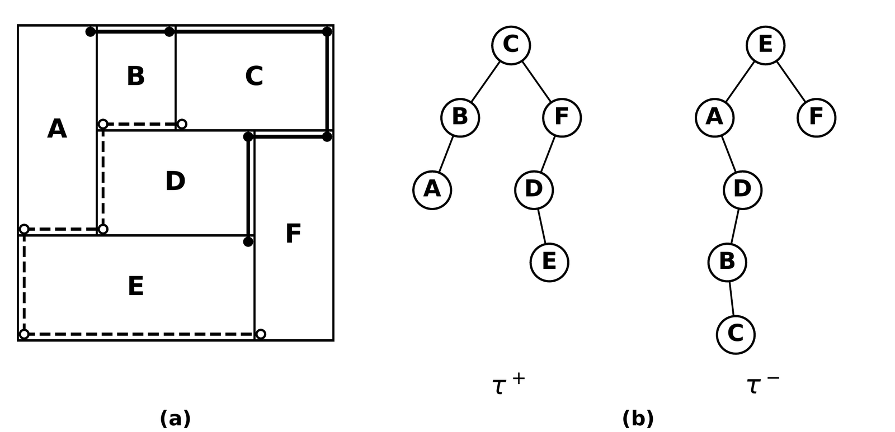
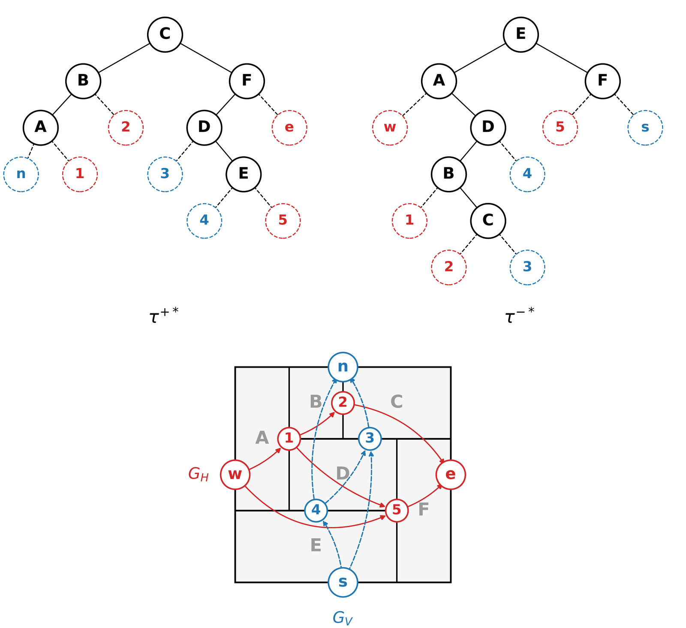
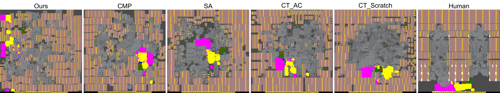

  <a href="/">← Yunqi He</a>
  <a href="/projects/physical-design-legalization/">Project: Physical Design Methodology &amp; Legalization</a>
  <a href="/publications/">All publications</a>

IEEE/ACM ICCAD 2026 · San Jose, CA

<h1>Quality-Preserving Legalization for Analytical Floorplanning</h1>

<strong>Yunqi He</strong>, You Li, Ruofan Huang, Hai Zhou

Northwestern University · NuLogiCS Research Group

  <a class="is-primary" href="/files/iccad2026-paper39.pdf"><i class="fas fa-file-pdf"></i> Paper (PDF)</a>
  <a class="is-primary" href="/files/iccad2026-paper39-slides.pdf"><i class="fas fa-chalkboard"></i> Slides (PDF)</a>
  <a href="https://doi.org/10.1145/3831252.3833939"><i class="fas fa-link"></i> ACM Digital Library</a>
  <a href="#cite"><i class="fas fa-quote-right"></i> BibTeX</a>

  
<b>7 / 8</b>OpenROAD designs with best or tied-best post-route WNS and TNS vs. Hier-RTLMP and TritonMacroPlace

  
<b>63–74×</b>faster end to end than TritonMacroPlace on ariane133 / ariane136

  
<b>1–12 min</b>on one CPU in the Cadence flow, vs. hours on 80 CPUs (SA) or 8 GPUs + 576 CPUs (Circuit Training)

  
<b>0 overlaps</b>at every iteration: legal and topology-preserving by construction (Theorems 1 and 2)

<h2>Abstract</h2>

Floorplanning is a crucial step in VLSI physical design. Analytical floorplanning, which determines macro positions through electrostatic-based mixed-size placement, has become the most prevalent paradigm. However, the resulting floorplan contains inter-macro overlaps that must be resolved by a legalization step. Existing methods minimize displacement from the analytical floorplan without effective topological guidance, leading to inconsistent downstream quality. In this paper, we propose a new legalization workflow that preserves the high quality of analytical floorplanning. We leverage twin binary trees to capture the relation between adjacent blocks, and build a differentiable model to optimize their coordinates. Experiments on TILOS MacroPlacement benchmarks show that our method enables analytical floorplanning to match or surpass commercial and open-source macro placement tools in post-route timing and wirelength.

<h2>Why topology matters</h2>

Electrostatics-based analytical placers such as ePlace, RePlAce, and DREAMPlace produce high-quality floorplans, but the macros overlap and a legalizer has to resolve that. An analytical floorplan carries two kinds of information: the macro <strong>positions</strong>, and the <strong>topology</strong>, i.e. which macro sits left of, right of, above, or below which. Both determine post-route PPA. Existing legalizers minimize displacement only and leave the topology to chance.

<figure>
  
  <figcaption>Five data-cache macros (A–E) of ariane133. Greedy legalization (b) flips three relative orders and gives the worst post-route slack. LP (c) keeps every order but doubles the displacement and needs a 44% larger die to be feasible. Ours (d) keeps every order with the smallest displacement.</figcaption>
</figure>

<h2>Method</h2>

The legalizer never reorders macros. It fixes the topology once with twin binary trees, then runs gradient descent on the only free variables left, the sizes of the filler blocks between macros.

<figure>
  
  <figcaption>Pipeline on bp_fe_top. Preprocessing runs once: padding and uniform shrinking, incremental mosaic construction, and MFTB to extract the twin binary trees. Then each iteration runs the TBMF forward model, measures the squared displacement of macro centers, back-propagates through autograd, and takes an Adam step on the filler sizes.</figcaption>
</figure>

<ul>
  <li><strong>Twin binary trees.</strong> Mosaic floorplans correspond one-to-one with pairs of binary trees (Yao et al.). Unlike sequence pairs or B*-trees the representation is non-redundant and captures the complete adjacency information. The trees are extracted once with MFTB and held fixed, so the topology is invariant by construction.</li>
  <li><strong>Preparation and mosaic construction.</strong> Macro padding (an AutoDMP-style halo in the LEF) makes the analytical floorplan spacing-aware; uniform shrinking removes all overlaps with the largest common scale factor; an incremental mosaic builder inserts filler blocks so that every internal boundary ends in a T-junction, never a cross.</li>
  <li><strong>TBMF as a differentiable forward model.</strong> Reconstructing coordinates from the trees is a longest-path computation on horizontal and vertical constraint graphs, i.e. only additions and <code>max</code> operations. Coordinates are therefore piecewise linear in the block sizes, and each <code>max</code> routes the gradient to its current longest predecessor, like a ReLU. Macros keep their real sizes; filler widths and heights are the only variables; the loss is the squared displacement of macro centers from the analytical floorplan, minimized with Adam.</li>
  <li><strong>Guarantees.</strong> For any non-negative sizes the reconstructed floorplan has no overlaps (Theorem 1) and the relative positions of all blocks are unchanged (Theorem 2). Every iterate is a legal, topology-preserving floorplan, with no die expansion.</li>
</ul>

  <figure>
    
    <figcaption>A six-block mosaic floorplan (a) and its twin binary trees τ⁺ and τ⁻ (b).</figcaption>
  </figure>
  <figure>
    
    <figcaption>Augmented trees with virtual leaves, and the constraint graphs GH and GV whose longest paths give the block coordinates.</figcaption>
  </figure>

<h2>Results</h2>

<ul>
  <li><strong>Against other legalizers</strong> (OpenROAD, all 8 macro-containing Nangate45 designs, identical RePlAce input): the lowest mean displacement on 7 of 8 designs with consistent post-route timing. Greedy legalization flips orders and breaks the downstream flow on black_parrot; LP keeps orders but needs a larger die on 6 of 8 designs, up to +44%.</li>
  <li><strong>End to end in OpenROAD:</strong> RePlAce + our legalization reaches best or tied-best WNS and TNS on 7 of 8 designs and the shortest routed wirelength on 6 of 8 against Hier-RTLMP and TritonMacroPlace, 63–74× faster than TritonMacroPlace on ariane133 and ariane136.</li>
  <li><strong>Commercial flow</strong> (Cadence Genus + Innovus, TILOS MacroPlacement ariane133 and bp_quad on Nangate45 and ASAP7): PPA comparable to Cadence CMP and shorter wirelength than Circuit Training in all four configurations, in 1–12 minutes on one CPU.</li>
  <li><strong>Ablation:</strong> macro padding plus the incremental mosaic builder cut mean displacement on ariane133 from 78.6 µm to 12.7 µm and the maximum from 311.9 µm to 80.9 µm. One Adam setting (learning rate 1.0, gradient clipping at 100, early stop at 0.1%) converges in a few hundred iterations on all ten benchmarks.</li>
</ul>

<figure>
  
  <figcaption>Post-route bp_quad layouts (Nangate45, 220 macros, 1.3 ns clock): ours, Cadence CMP, simulated annealing, Circuit Training, and the human expert floorplan. Our wirelength is within 5% of CMP and the human expert; SA and Circuit Training need about 25% more.</figcaption>
</figure>

<h2>Talk at ICCAD 2026</h2>

  
<strong>Session:</strong> Scalable Optimization for Floorplanning, Partitioning, and Chiplet-Based Design

  
<strong>When:</strong> Monday, November 9, 2026, 13:30–15:00

  
<strong>Where:</strong> San Jose Ballroom, San Jose, CA

  
<a href="/files/iccad2026-paper39-slides.pdf">Download the slides (PDF)</a>

<h2 id="cite">Citation</h2>

<pre>@inproceedings{he2026qplegalization,
  title     = {Quality-Preserving Legalization for Analytical Floorplanning},
  author    = {He, Yunqi and Li, You and Huang, Ruofan and Zhou, Hai},
  booktitle = {Proceedings of the IEEE/ACM International Conference on Computer-Aided Design (ICCAD)},
  year      = {2026},
  doi       = {10.1145/3831252.3833939}
}</pre>

Contact: <a href="mailto:yunqi.he@u.northwestern.edu">yunqi.he@u.northwestern.edu</a>

  <a href="/">← Back to Yunqi He's home page</a>
  <a href="/projects/physical-design-legalization/">Project page</a>
  <a href="/publications/">All publications</a>

