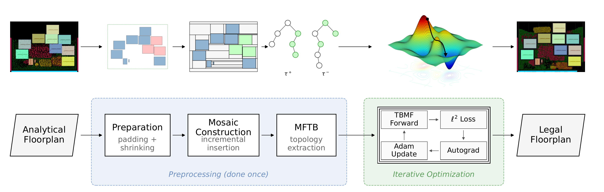

## Project Overview

This project develops **physical-design methodology** and production-oriented flows that improve SoC **PPA** (power, performance, area) across placement, legalization, and floorplanning. The central theme is turning the continuous solutions produced by analytical engines into **legal, physically valid layouts** without sacrificing wirelength, area, or timing — and doing so at industrial scale.

## Core Contribution: Quality-Preserving Legalization (ICCAD 2026)

**Quality-Preserving Legalization for Analytical Floorplanning**
Yunqi He, You Li, Ruofan Huang, Hai Zhou
*IEEE/ACM International Conference on Computer-Aided Design (ICCAD), San Jose, CA, November 2026*

[Paper page: figures, slides, PDF, BibTeX →](/papers/qp-legalization-iccad26/){: .btn .btn--primary}
[Paper (PDF)](/files/iccad2026-paper39.pdf){: .btn .btn--inverse}
[Slides (PDF)](/files/iccad2026-paper39-slides.pdf){: .btn .btn--inverse}
[DOI](https://doi.org/10.1145/3831252.3833939){: .btn .btn--inverse}

Electrostatics-based analytical placers leave **overlapping macros**, and the legalizer that resolves them decides whether the placer's quality survives. An analytical floorplan carries both macro **positions** and **topology** (which macro is left of, right of, above, or below which); existing legalizers minimize displacement only and leave the topology to chance.

<figure>
  
  <figcaption>Preprocess once (padding, uniform shrinking, mosaic construction, MFTB), then iterate a differentiable TBMF forward model with gradient descent on the filler sizes.</figcaption>
</figure>

- **Twin binary trees** capture the complete adjacency of the analytical floorplan and are held fixed, so the topology is invariant by construction.
- **Differentiable TBMF**: reconstructing coordinates from the trees uses only additions and `max`, so coordinates are piecewise linear in the filler sizes and autograd optimizes them with Adam. Every iterate is legal, with no die expansion (Theorems 1 and 2).
- **Results**: lowest mean displacement on 7 of 8 OpenROAD designs against Greedy and LP legalizers; best or tied-best post-route WNS/TNS on 7 of 8 designs and shortest routed wirelength on 6 of 8 against Hier-RTLMP and TritonMacroPlace, 63–74× faster; on the Cadence flow (TILOS ariane133 and bp_quad, Nangate45 and ASAP7), PPA comparable to Cadence CMP in 1–12 minutes on one CPU.

The [paper page](/papers/qp-legalization-iccad26/) has the full write-up, figures, slides, and talk details (ICCAD 2026, November 9, San Jose Ballroom).

## GPU-Accelerated Placement (Industry)

During two R&D internships at **Cadence Design Systems**, this line of work moved analytical placement onto the GPU inside a commercial emulation flow.

- Integrated GPU-accelerated placement (**DREAMPlace**) into Palladium (Z3) design flows, achieving **6–12× speedup** over CPU baselines on multi-million-cell industrial designs while maintaining solution quality and convergence stability.
- Analyzed **CUDA kernel** performance and memory behavior for large-scale mixed-size placement workloads.
- Built interfaces bridging academic GPU-accelerated kernels with commercial flows, enabling heterogeneous CPU–GPU execution and rapid prototyping of ML-enhanced placement in production-like environments.

## Why It Matters

Legalization and placement acceleration are exactly the points where academic algorithms meet production reality. By preserving quality through legalization and delivering large speedups through GPU acceleration, this work provides reliable primitives that downstream engines — and an agentic design flow — can invoke with confidence.

## Related Publications

1. **Quality-Preserving Legalization for Analytical Floorplanning** — Yunqi He, You Li, Ruofan Huang, Hai Zhou. ICCAD 2026. [Paper page](/papers/qp-legalization-iccad26/) · [PDF](/files/iccad2026-paper39.pdf) · [Slides](/files/iccad2026-paper39-slides.pdf) · [DOI](https://doi.org/10.1145/3831252.3833939)

## Future Directions

- Layout optimization with a generative model or an RL agent on top of the same differentiable legalization model.
- Hierarchical legalization with super-blocks for very large macro counts; first-class fence and region constraints.
- Tighter coupling between GPU-accelerated placement and timing/congestion analysis.
- Legalization primitives exposed as reliable actions for an LLM-driven agentic design flow.
